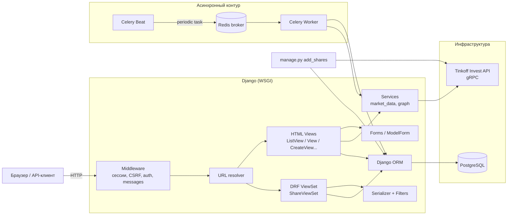
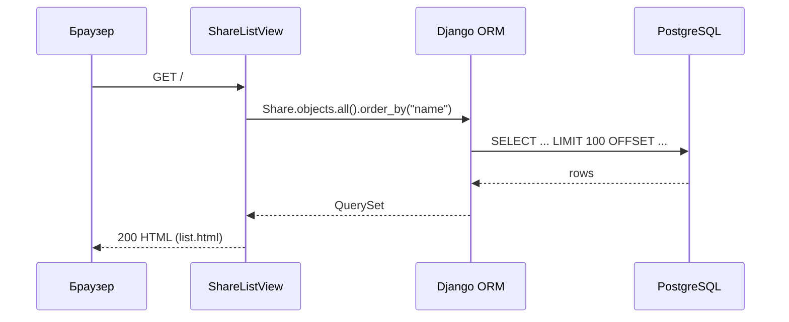
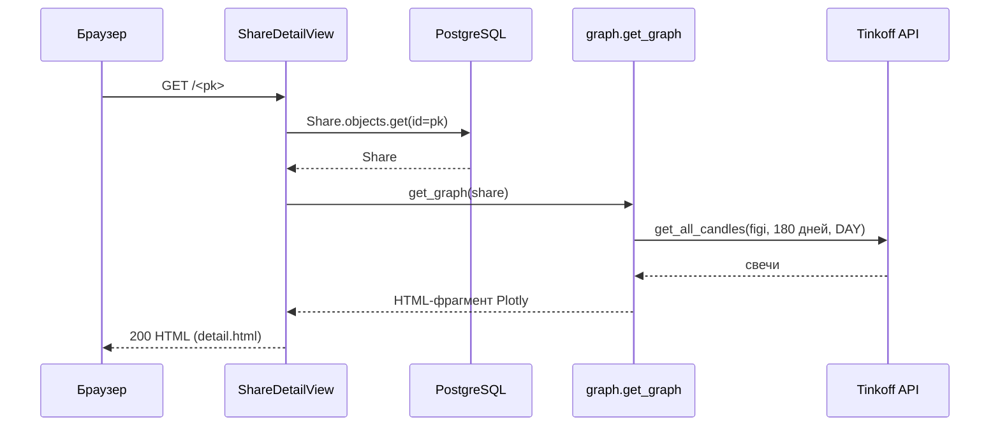
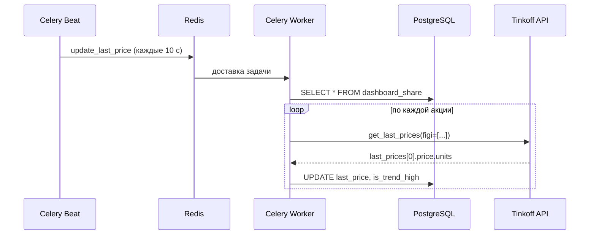
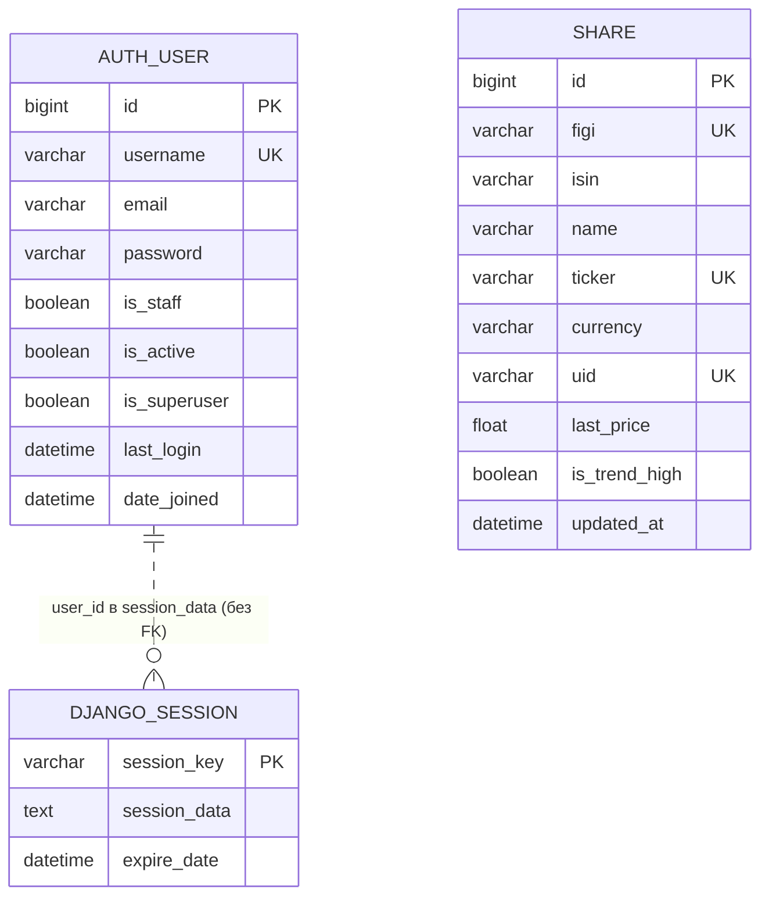

# Анализ проекта Investing Demo

> Задание №1. Анализ исходного кода.
> Документ подготовлен по состоянию ветки `deepseekbranch` (коммит `362510b`).
> Анализ выполнен статически, по исходному коду; зависимости проекта в локальном окружении не установлены.

## 1. Назначение приложения и технологический стек

### 1.1. Назначение

**Investing Demo** — демонстрационное веб-приложение для мониторинга акций через
Tinkoff Invest API. Приложение позволяет:

- просматривать каталог акций с текущей ценой и признаком роста/падения;
- открывать карточку акции с графиком дневных цен за последние 180 дней;
- регистрировать пользователей и выполнять вход/выход;
- добавлять, редактировать и удалять акции через веб-интерфейс (только для
  аутентифицированных пользователей);
- выполнять CRUD-операции над акциями через REST API;
- автоматически обновлять последнюю цену акций фоновой задачей Celery;
- однократно загружать справочник акций из Tinkoff Invest API management-командой.

Это не персональный инвестиционный сервис: нет портфелей, избранного, целевых
цен, истории цен в БД и привязки данных к пользователю. Каталог акций является
общим и глобальным.

### 1.2. Технологический стек

| Слой | Технология | Версия / файл |
|---|---|---|
| Язык | Python | версия не зафиксирована; локально 3.14.7 |
| Web-фреймворк | Django | 4.1.7 |
| Архитектурный паттерн | MVT (Model–View–Template) | — |
| REST API | Django REST Framework | 3.14.0 |
| Фильтрация API | django-filter | 22.1 |
| Формы | django-crispy-forms + crispy-bootstrap3 | 2.0 / 2022.1 |
| БД | PostgreSQL | `postgres:latest` в docker-compose |
| Драйвер БД | psycopg2-binary | 2.9.5 |
| Очередь задач | Celery | 5.2.7 |
| Брокер | Redis | `redis:latest`, клиент `redis==4.5.1` |
| Планировщик | Celery Beat | встроенный |
| Внешний API | Tinkoff Invest API (gRPC) | `tinkoff-investments==0.2.0b50`, `grpcio==1.51.3` |
| Визуализация | Plotly (offline div) | 5.13.1 |
| Frontend | Django Templates, Bootstrap 5.1.3, jQuery 3.3.1, Moment.js, Tempus Dominus, Font Awesome 4.7 | CDN + локальный CSS |
| Контейнеризация | Docker Compose | только PostgreSQL и Redis |

Приложение реализовано как **монолитный Django-проект** с двумя приложениями
(`dashboard`, `user`), синхронным HTTP-слоем и асинхронным контуром Celery.

### 1.3. Текущее состояние

- Проект не запускается «из коробки»: `SECRET_KEY` и `TINKOFF_TOKEN` пусты
  (`config/settings.py:6`, `config/settings.py:134`), реквизиты БД захардкожены.
- Зависимости датированы 2023 годом: Django 4.1.7 снят с поддержки, Python 3.14
  официально не поддерживается Django 4.1.
- В `requirements.txt` одновременно присутствуют `tinkoff==0.1.1` и
  `tinkoff-investments==0.2.0b50`; первый пакет не используется в коде и создаёт
  риск конфликта пространства имён `tinkoff`.
- `docker-compose.yml` не содержит сервисов web/worker/beat и не сохраняет данные
  PostgreSQL в именованном томе.

## 2. Структура проекта и основные компоненты

### 2.1. Дерево проекта

```text
.
├── manage.py                     # точка входа Django
├── requirements.txt              # фиксированные зависимости
├── docker-compose.yml            # PostgreSQL + Redis
├── README.md                     # команды запуска
├── HOMEWORK.md                   # условие задания
├── config/                       # project-конфигурация
│   ├── settings.py               # настройки Django, DRF, Celery, БД, логирование
│   ├── urls.py                   # корневая маршрутизация
│   ├── celery.py                 # Celery app + beat schedule
│   ├── wsgi.py / asgi.py         # точки входа WSGI/ASGI
│   └── __init__.py               # экспорт celery_app
├── dashboard/                    # доменное приложение «акции»
│   ├── models.py                 # модель Share
│   ├── views.py                  # HTML CRUD-представления
│   ├── forms.py                  # ModelForm акции
│   ├── urls.py                   # HTML-маршруты + подключение API
│   ├── admin.py                  # регистрация в Django Admin
│   ├── tasks.py                  # Celery-задача обновления цен
│   ├── services/
│   │   ├── market_data.py        # получение последней цены из Tinkoff
│   │   └── graph.py              # построение графика Plotly
│   ├── api/
│   │   ├── urls.py               # /api/ → v1
│   │   └── v1/
│   │       ├── router.py         # DefaultRouter, регистрация shares
│   │       ├── views.py          # ShareViewSet, ShareFilter
│   │       ├── serializer.py     # ShareSerializer
│   │       └── urls.py           # подключение router.urls
│   ├── management/commands/
│   │   └── add_shares.py         # импорт справочника акций
│   ├── migrations/               # 7 миграций модели Share
│   ├── templates/dashboard/      # base/list/detail/create/delete
│   └── static/dashboard/css/     # Bootstrap 5, sticky-footer
└── user/                         # приложение аутентификации
    ├── views.py                  # вход, регистрация, выход
    ├── forms.py                  # AuthForm, RegistrationForm
    ├── urls.py                   # /user/login, /registration, /logout
    ├── models.py                 # алиас стандартной модели User
    ├── templates/user/           # base/auth/registration
    └── static/user/css/          # Bootstrap 5, signin.css
```

### 2.2. Назначение компонентов

| Компонент | Назначение | Ключевые файлы |
|---|---|---|
| `config` | Конфигурация проекта: настройки, БД, middleware, DRF, Celery, логирование, корневой URLconf | `config/settings.py`, `config/urls.py`, `config/celery.py` |
| `dashboard` | Основной домен: каталог акций, HTML CRUD, REST API, графики, фон обновления цен, импорт справочника | `dashboard/models.py`, `views.py`, `api/v1/*`, `services/*`, `tasks.py` |
| `user` | Регистрация, аутентификация, выход; использует стандартную `django.contrib.auth.models.User` | `user/views.py`, `user/forms.py`, `user/urls.py` |
| `dashboard.services.market_data` | Интеграция с Tinkoff Invest API: последняя цена по FIGI | `dashboard/services/market_data.py` |
| `dashboard.services.graph` | Получение дневных свечей за 180 дней и рендеринг Plotly-графика в HTML-фрагмент | `dashboard/services/graph.py` |
| `dashboard.tasks` | Периодическое обновление цен и флага тренда | `dashboard/tasks.py` |
| `add_shares` | Однократная загрузка справочника акций из Tinkoff | `dashboard/management/commands/add_shares.py` |
| `dashboard.api.v1` | REST API каталога акций (ModelViewSet + router) | `dashboard/api/v1/*` |
| Django Admin | Административный интерфейс модели `Share` | `dashboard/admin.py` |
| Шаблоны | Серверный рендеринг HTML (MVT), Bootstrap-вёрстка | `*/templates/*` |

## 3. Архитектура приложения и взаимодействие компонентов

### 3.1. Общая схема

Приложение построено по классической схеме Django MVT с выделенным сервисным
слоем и отдельным асинхронным контуром:



### 3.2. Слои и их взаимодействие

1. **Слой представления (HTTP).**
   - HTML-запросы обслуживаются function-based/class-based views в
     `dashboard/views.py` и `user/views.py`.
   - REST-запросы обслуживаются `ShareViewSet` (`dashboard/api/v1/views.py`).
   - Маршрутизация: `config/urls.py` → `dashboard/urls.py` / `user/urls.py` →
     `dashboard/api/urls.py` → `dashboard/api/v1/urls.py` → router.

2. **Слой форм и сериализации.**
   - HTML: `ShareModelForm` (все редактируемые поля `Share`), `AuthForm`,
     `RegistrationForm`.
   - API: `ShareSerializer` (ModelSerializer, 9 полей).
   - Валидация HTML-форм выполняется Django Forms; API-валидация — DRF
     Serializer. Единой доменной валидации нет.

3. **Сервисный слой.**
   - `get_last_data(share)` — синхронный вызов Tinkoff gRPC, возвращает
     `[units, time]`.
   - `get_graph(share)` — синхронно получает дневные свечи за 180 дней и
     возвращает HTML-фрагмент Plotly.
   - Сервисы не изолированы от Django settings: импортируют `TINKOFF_TOKEN` и
     `logger` напрямую.

4. **Слой доступа к данным.**
   - Django ORM, без отдельного repository/DAO.
   - Используются `QuerySet`, `objects.get`, `objects.filter().update`,
     `get_or_create`.
   - Явные транзакции (`atomic`) не используются; работает autocommit.

5. **Асинхронный контур.**
   - Celery Beat публикует задачу `dashboard.tasks.update_last_price` в Redis.
   - Worker забирает задачу, читает все `Share` из PostgreSQL, для каждой делает
     запрос в Tinkoff и обновляет `last_price`/`is_trend_high`.
   - Результаты задач нигде не сохраняются (result backend не настроен).

6. **Внешние системы.**
   - Tinkoff Invest API — единственный источник рыночных данных.
   - PostgreSQL — единственное хранилище.
   - Redis — только брокер Celery.
   - CDN — Plotly, jQuery, Popper, Moment.js, Tempus Dominus, Font Awesome
     (шаблоны `dashboard/base.html`, `user/base.html`).

### 3.3. Сценарии взаимодействия

#### Просмотр списка акций



`ShareListView` (`dashboard/views.py:20-26`) использует `paginate_by = 100` и
`ordering = ["name"]`. Шаблон выводит тикер, название, ISIN, цену и цветовую
индикацию тренда, а для аутентифицированных пользователей — кнопки
редактирования/удаления (`dashboard/templates/dashboard/list.html`).

#### Просмотр карточки акции и графика



`ShareDetailView` (`dashboard/views.py:29-38`) — обычный `View` со статическим
`get`. Обращение к Tinkoff выполняется **синхронно внутри HTTP-запроса**, поэтому
время ответа зависит от внешнего API. Отсутствие `Share` приводит к
`Share.DoesNotExist` и ответу 500, а не 404.

#### Создание, редактирование и удаление акции (HTML)

- `/create` — `CreateView` + `ShareModelForm`, требует аутентификации через
  `IsUserAuthenticatedMixin` (`dashboard/views.py:11-17, 41-46`).
- `/update/<pk>` — `UpdateView` с той же формой (`dashboard/views.py:49-55`).
- `/delete/<pk>` — `DeleteView` с подтверждением (`dashboard/views.py:58-63`).
- При отсутствии аутентификации `UserPassesTestMixin` вызывает
  `handle_no_permission`, который перенаправляет на главную страницу, а не на
  страницу входа.

#### Регистрация и аутентификация

- `GET /user/login/` и `GET /user/registration/` рендерят формы.
- `POST /user/login/` вызывает `authenticate(username=email.lower(), password=...)`,
  при успехе — `login()` и редирект на главную (`user/views.py:15-33`).
- `POST /user/registration/` валидирует форму, создаёт пользователя
  `User.objects.create_user(email, email, password)` и сразу выполняет вход
  (`user/forms.py:48-53`, `user/views.py:43-55`).
- `GET /user/logout/` выполняет `logout()` и редирект на главную.
  Выход через GET не защищён от CSRF, но соответствует текущей реализации.

#### REST API

`DefaultRouter` регистрирует `shares` (`dashboard/api/v1/router.py`), поэтому
доступны:

| Метод | URL | Действие |
|---|---|---|
| GET | `/api/v1/shares/` | список (пагинация 100, фильтры, поиск, сортировка) |
| POST | `/api/v1/shares/` | создание |
| GET | `/api/v1/shares/{id}/` | детали |
| PUT / PATCH | `/api/v1/shares/{id}/` | полное/частичное обновление |
| DELETE | `/api/v1/shares/{id}/` | удаление |
| GET | `/api/v1/` | корень router (список эндпоинтов) |

API не требует аутентификации: глобальные permissions в `REST_FRAMEWORK` не
заданы (`config/settings.py:31-35`), поэтому действует `AllowAny`.

#### Фоновое обновление цен



Расписание задано в `config/celery.py:13-18`; имя задачи
`"add-every-5-min"` не соответствует фактическому интервалу `10.0` секунд.
Задача `update_last_price` (`dashboard/tasks.py:7-28`) последовательно обходит
все акции. Для каждой акции создаётся новый gRPC-клиент
(`dashboard/services/market_data.py:6-11`), что даёт накладные расходы
`O(N)` подключений за один запуск.

#### Импорт справочника акций

`python manage.py add_shares` (`dashboard/management/commands/add_shares.py`)
вызывает `client.instruments.shares()` и для каждого инструмента выполняет
`Share.objects.get_or_create(figi=..., name=..., isin=..., ticker=...,
currency=..., uid=...)`. Команда не фильтрует инструменты по торгуемости и
типу, не обрабатывает пагинацию ответа Tinkoff и использует изменяемые поля
(`name`, `isin`, `ticker`) в ключе поиска.

## 4. Используемые библиотеки и внешние зависимости

### 4.1. Прикладные зависимости

| Библиотека | Версия | Назначение | Замечания |
|---|---|---|---|
| Django | 4.1.7 | Web-фреймворк, ORM, admin, auth, sessions | EOL, не поддерживает Python 3.12+ |
| djangorestframework | 3.14.0 | REST API, ViewSet, сериализация, пагинация | совместим с Django 4.1 |
| django-filter | 22.1 | Фильтрация API по полям | старый релиз |
| django-crispy-forms | 2.0 | Рендеринг форм | — |
| crispy-bootstrap3 | 2022.1 | Bootstrap 3-шаблоны для crispy | конфликт с Bootstrap 5 в статике |
| psycopg2-binary | 2.9.5 | Драйвер PostgreSQL | бинарная сборка, не рекомендуется для production |
| celery | 5.2.7 | Асинхронные задачи и Beat | старый релиз |
| redis | 4.5.1 | Клиент Redis (брокер) | — |
| kombu / amqp / billiard / vine | 5.2.4 / 5.1.1 / 3.6.4.0 / 5.0.0 | Транзитивные зависимости Celery | — |
| tinkoff-investments | 0.2.0b50 | Официальный SDK Tinkoff Invest (gRPC) | beta-версия |
| tinkoff | 0.1.1 | Не используется в коде | вероятный конфликт имён с SDK |
| grpcio | 1.51.3 | gRPC-транспорт | старая версия |
| protobuf | 3.20.3 | Protobuf-сообщения Tinkoff | жёсткий пин, ограничивает обновление |
| pydantic | 1.10.6 | Валидация в SDK/транзитивно | ветка 1.x |
| plotly | 5.13.1 | Построение графиков | тяжёлый HTML-фрагмент |
| python-dateutil, pytz, six | 2.8.2 / 2022.7 / 1.16.0 | Работа с датами/совместимость | транзитивные |
| sqlparse, asgiref, packaging, cachetools, tenacity, async-timeout | — | Транзитивные зависимости | — |
| black, isort, mypy-extensions, pathspec, platformdirs, click, tomli, typing_extensions, prompt-toolkit, wcwidth | — | Инструменты разработки/CLI | находятся в runtime-requirements |

### 4.2. Внешние сервисы и инфраструктура

| Зависимость | Способ интеграции | Конфигурация |
|---|---|---|
| Tinkoff Invest API | gRPC через `tinkoff.invest.Client` | `TINKOFF_TOKEN` в `config/settings.py` (пуст) |
| PostgreSQL | Django ORM / psycopg2 | `config/settings.py:91-104`, БД `investing` |
| Redis | Celery broker | `CELERY_BROKER_URL = redis://127.0.0.1:6379/0` |
| Docker Compose | `postgres:latest`, `redis:latest` | `docker-compose.yml` |
| CDN Plotly/jQuery/Popper/Moment/Tempus Dominus/Font Awesome | `<script>`/`<link>` в шаблонах | внешние URL, требуют интернета |
| Bootstrap 5.1.3 | локальные CSS-файлы в `static/` | `dashboard/static`, `user/static` |

### 4.3. Ограничения окружения

- Версии Python в проекте не зафиксированы (нет `runtime.txt`, `.python-version`,
  Dockerfile).
- Нет lock-файла, хэшей пакетов и разделения production/dev-зависимостей.
- `requirements.txt` содержит несовместимые по смыслу пакеты `tinkoff` и
  `tinkoff-investments`.
- Локально установлен Python 3.14.7; Django 4.1.7 официально поддерживает
  Python 3.8–3.11, поэтому проект в текущем окружении не гарантированно
  запускается.

## 5. Модель данных

### 5.1. Сущность `Share` (Акция)

Единственная доменная модель проекта — `Share` (`dashboard/models.py:4-21`).

| Атрибут | Тип | Ограничения | Назначение |
|---|---|---|---|
| `id` | `BigAutoField` | PK, auto | Суррогатный идентификатор |
| `figi` | `CharField(255)` | unique, NOT NULL | Financial Instrument Global Identifier |
| `isin` | `CharField(255)` | NOT NULL | International Securities Identification Number |
| `name` | `CharField(255)` | NOT NULL | Наименование компании |
| `ticker` | `CharField(10)` | unique, NOT NULL | Биржевой тикер |
| `currency` | `CharField(20)` | NOT NULL | Валюта цены (например, `rub`, `usd`) |
| `uid` | `CharField(255)` | unique, NOT NULL | Уникальный идентификатор инструмента в Tinkoff |
| `last_price` | `FloatField` | null, blank | Последняя известная цена |
| `is_trend_high` | `BooleanField` | null, blank | Признак «цена растёт» (трёхзначная логика: True/False/NULL) |
| `updated_at` | `DateTimeField` | auto_now, null, blank | Время последнего изменения записи |

Особенности:

- Нет `created_at`, нет истории цен, нет версионирования.
- Нет внешних ключей и связей с пользователем.
- Денежные значения хранятся в `FloatField`, а не в `DecimalField`, что не
  подходит для точных финансовых расчётов.
- `is_trend_high` допускает `NULL`, то есть «тренд неизвестен».
- Уникальность `figi`, `ticker`, `uid` обеспечивается ограничениями БД.
- `updated_at` с `auto_now=True` обновляется при `save()`, но **не** при
  `QuerySet.update()`, который используется в фоновой задаче.

### 5.2. Пользовательская модель

Собственной модели пользователя нет: `user/models.py` содержит только алиас
`User = get_user_model()`. Используется стандартная `django.contrib.auth.models.User`:

| Атрибут | Назначение |
|---|---|
| `id` | PK |
| `username` | при регистрации сохраняется email |
| `email` | email пользователя |
| `password` | хэш пароля |
| `first_name`, `last_name` | не используются |
| `is_staff`, `is_active`, `is_superuser` | стандартные флаги Django |
| `last_login`, `date_joined` | служебные даты |
| `groups`, `user_permissions` | M2M-связи стандартной auth-модели |

### 5.3. Служебные таблицы Django

Дополнительно в БД создаются стандартные таблицы:

- `auth_user`, `auth_group`, `auth_permission`, `auth_user_groups`,
  `auth_user_user_permissions`;
- `django_session` — серверные сессии;
- `django_content_type`;
- `django_admin_log` — журнал действий администратора;
- `django_migrations` — история миграций.

### 5.4. ER-диаграмма



Связей между `Share` и `User` нет. Это ключевое ограничение модели: каталог
акций общий, а все аутентифицированные пользователи могут редактировать и
удалять любые записи. Для будущих функций (watchlist, портфель, стратегии,
история цен) потребуется расширение модели.

### 5.5. История миграций

| Миграция | Изменение |
|---|---|
| `0001_add_share` | создание `Share` (id, figi, isin, name, ticker, currency) |
| `0002_update_share` | уникальность `figi`, `ticker` |
| `0003_add_uuid` | добавление `uid` (unique) |
| `0004_add_last_price` | `last_price`, `is_trend_high`, verbose_name |
| `0005_add_verbose_name` | исправление verbose_name для `name` |
| `0006_add_verbose_name` | исправление verbose_name для `ticker` |
| `0007_add_updated_at` | добавление `updated_at` |

Миграции отражают эволюцию модели и в целом соответствуют текущему
`dashboard/models.py`. В `0004` были ошибочные verbose_name («Валюта» для
`name`, «Ти» для `ticker`), исправленные в `0005`–`0006`.

## 6. Механизмы обработки запросов и взаимодействия с БД

### 6.1. Маршрутизация

Корневой `config/urls.py`:

| Префикс | Подключение | Назначение |
|---|---|---|
| `/admin/` | `admin.site.urls` | Django Admin |
| `/` | `dashboard.urls` | HTML-страницы и `/api/` |
| `/user` | `user.urls` | аутентификация |

`dashboard/urls.py`:

| URL | View | Имя | Доступ |
|---|---|---|---|
| `/` | `ShareListView` | `dashboard:index` | публичный |
| `/<int:pk>` | `ShareDetailView` | `dashboard:detail` | публичный |
| `/create` | `ShareCreateView` | `dashboard:create` | только auth |
| `/update/<int:pk>` | `ShareUpdateView` | `dashboard:update` | только auth |
| `/delete/<int:pk>` | `ShareDeleteView` | `dashboard:delete` | только auth |
| `/api/` | `dashboard.api.urls` | — | публичный |

`user/urls.py` (`app_name = "user"`):

| URL | View | Имя |
|---|---|---|
| `/user/login/` | `AuthView` | `user:auth` |
| `/user/registration/` | `RegistrationView` | `user:registration` |
| `/user/logout/` | `LogoutView` | `user:logout` |

`dashboard/api/urls.py` → `dashboard/api/v1/urls.py` → `DefaultRouter`:
`/api/v1/shares/`, `/api/v1/shares/{pk}/`, `/api/v1/`.

### 6.2. Middleware

Порядок из `config/settings.py:61-69`:

1. `SecurityMiddleware` — security-заголовки.
2. `SessionMiddleware` — сессии на основе cookie + `django_session`.
3. `CommonMiddleware` — редиректы, `APPEND_SLASH`.
4. `CsrfViewMiddleware` — CSRF-защита HTML-форм.
5. `AuthenticationMiddleware` — `request.user` из сессии.
6. `MessageMiddleware` — flash-сообщения.
7. `XFrameOptionsMiddleware` — защита от clickjacking.

DRF-настройки аутентификации глобально не заданы, поэтому действуют значения
по умолчанию (`SessionAuthentication`, `BasicAuthentication`), но permissions
не ограничены: API доступен анонимно.

### 6.3. HTML-представления и ORM

| View | Базовый класс | Работа с БД |
|---|---|---|
| `ShareListView` | `ListView` | `Share.objects.all()`, сортировка по `name`, пагинация 100 |
| `ShareDetailView` | `View` | `Share.objects.get(id=pk)` |
| `ShareCreateView` | `CreateView` | `form.save()` → `INSERT` |
| `ShareUpdateView` | `UpdateView` | `form.save()` → `UPDATE` |
| `ShareDeleteView` | `DeleteView` | `object.delete()` → `DELETE` |

Формы:

- `ShareModelForm` — `ModelForm` с `fields = "__all__"`. В форму попадают все
  редактируемые поля, включая технические `figi`, `isin`, `uid`, `last_price`,
  `is_trend_high`; `updated_at` исключается как non-editable.
- `AuthForm` и `RegistrationForm` — обычные `forms.Form`, не `ModelForm`.
  Регистрация вручную вызывает `User.objects.create_user`.

Шаблоны используют серверный рендеринг, наследование (`base.html`) и
``. График вставляется как готовый HTML-фрагмент Plotly через
``.

### 6.4. REST API и фильтрация

`ShareViewSet` (`dashboard/api/v1/views.py:16-22`):

- `queryset = Share.objects.all()`;
- `serializer_class = ShareSerializer`;
- `filter_backends = (OrderingFilter, DjangoFilterBackend, SearchFilter)`;
- `filterset_class = ShareFilter` — точное совпадение по `name` и `ticker`;
- `ordering_fields = ["name", "ticker"]`;
- `search_fields = ["$name"]` — префиксный поиск по имени (DRF `istartswith`);
- глобальная пагинация `LimitOffsetPagination`, `PAGE_SIZE = 100`
  (`config/settings.py:31-35`).

`ShareSerializer` включает `id`, `figi`, `isin`, `name`, `ticker`, `currency`,
`last_price`, `is_trend_high`, `updated_at`, но **не включает `uid`**, хотя
`uid` обязателен и уникален в модели. Это приводит к ошибке целостности при
создании через API: `POST /api/v1/shares/` не может передать `uid`.

### 6.5. Работа с БД в фоновой задаче

```python
# dashboard/tasks.py (упрощённо)
shares = Share.objects.all()
for share in shares:
    [last_price, detetime] = get_last_data(share)   # units, time
    if share.last_price > last_price:
        is_trend_high = False
    else:
        is_trend_high = True
    Share.objects.filter(id=share.id).update(
        last_price=last_price, is_trend_high=is_trend_high
    )
```

Особенности:

- Чтение всех акций одним `SELECT`, затем `N` вызовов Tinkoff и `N` `UPDATE`.
- Нет `select_related`/`prefetch` — не требуется, связей нет.
- Нет транзакции на весь цикл: частичное обновление возможно.
- `QuerySet.update()` обходит `auto_now`, поэтому `updated_at` не меняется.
- Сравнение `share.last_price > last_price` работает с `float` и `int`
  (`units`), игнорирует `nano`; при `last_price = NULL` возникает исключение,
  которое перехватывается и трактуется как «рост».
- `detetime` (опечатка в имени) не используется; время цены не сохраняется.
- Каждый вызов `get_last_data` открывает новый `Client(TINKOFF_TOKEN)`.

### 6.6. Импорт данных

`add_shares` — management-команда, запускаемая вручную. Она:

1. Открывает `Client(TINKOFF_TOKEN)`.
2. Получает `client.instruments.shares()`.
3. Для каждого инструмента вызывает `get_or_create` по набору полей.
4. Не сохраняет `last_price`/`is_trend_high` — они заполняются позже задачей.

Ограничения: нет обработки ошибок, пагинации, фильтрации по `ticker`/валюте,
нет `update_or_create` для обновления справочных данных.

### 6.7. Логирование и конфигурация

- Логирование настроено в `config/settings.py:37-59`: формат
  `[module asctime level] message`, обработчики `console` и файл `app.logs`.
- Логгер `main` используется в `tasks.py`, `market_data.py`.
- Секреты и параметры подключения хранятся прямо в `settings.py`; `.env` не
  используется, хотя `.gitignore` его исключает.
- `DEBUG = True`, `ALLOWED_HOSTS = []` — конфигурация рассчитана на локальный
  запуск.
- `SECRET_KEY = ""`, `TINKOFF_TOKEN = ""` — обязательные значения не заданы.

## 7. Ключевые наблюдения и ограничения текущей реализации

Ниже — факты, важные для восстановления требований (задание №2) и
модернизации (задание №3). Это не претензии к стилю, а риски, влияющие на
работоспособность и развитие.

### 7.1. Конфигурация и запуск

1. Пустые `SECRET_KEY` и `TINKOFF_TOKEN`; реквизиты PostgreSQL захардкожены.
2. `docker-compose.yml` поднимает только БД и Redis; нет сервисов Django,
   Celery Worker и Beat, нет Dockerfile, нет healthcheck, теги образов
   `latest` не фиксированы.
3. Том `./:/app` монтируется в контейнер PostgreSQL, но не в `PGDATA`;
   именованный том для данных БД не объявлен, каталог проекта в контейнере БД
   фактически не используется.
4. Зависимости 2023 года, Django 4.1.7 EOL; локальный Python 3.14.7
   несовместим с заявленным Django.
5. В requirements одновременно `tinkoff` и `tinkoff-investments`.
6. `CELERY_TASK_ALWAYS_EAGER = False`; без Redis и Worker обновление цен не
   работает, а `add_shares` требует токен.

### 7.2. Логика и данные

7. `ShareDetailView` не обрабатывает `DoesNotExist` → 500 вместо 404.
8. `ShareSerializer` не содержит `uid` → создание через API нарушает NOT NULL /
   UNIQUE ограничение.
9. `ShareModelForm` с `fields = "__all__"` позволяет вручную менять технические
   идентификаторы (`figi`, `uid`, `isin`) и рассчитанные поля (`last_price`,
   `is_trend_high`).
10. API-тесты в `dashboard/tests.py` не соответствуют текущей модели: при
    создании передают `uid`, который отсутствует в `ShareSerializer`, поэтому
    `test_share_create` не может пройти; тесты также требуют доступную
    PostgreSQL.
11. Фоновая задача не обновляет `updated_at` из-за `QuerySet.update()`.
12. Цена хранится как `FloatField` и только в `units`, без `nano`; сравнение
    `float > int` и `NULL`-значение дают некорректный тренд.
13. `is_trend_high` отражает лишь сравнение с предыдущим сохранённым значением,
    а не рыночный тренд.
14. Имя задачи `"add-every-5-min"` не соответствует интервалу 10 секунд.
15. `get_or_create` в `add_shares` использует изменяемые поля в ключе поиска,
    что может приводить к `IntegrityError` при изменении названия/тикера.
16. Нет истории цен, портфелей, watchlist, целевых уровней и уведомлений —
    модель данных не готова к функциям задания №4.

### 7.3. Безопасность и доступ

17. REST API полностью анонимный (`AllowAny`), включая создание, изменение и
    удаление.
18. HTML-изменение каталога доступно любому аутентифицированному пользователю;
    разграничения прав нет.
19. `UserPassesTestMixin` при отказе редиректит на главную, а не на логин.
20. Выход реализован через GET (`/user/logout/`), что позволяет CSRF-инициировать
    выход.
21. Пароли валидируются только стандартными валидаторами Django; форма
    регистрации не проверяет сложность пароля через `validate_password`.
22. Логин приводит email к нижнему регистру, а регистрация сохраняет его как
    введено — возможны проблемы входа при email в смешанном регистре.

### 7.4. UI и обработка ошибок

23. В `AuthView.get` и `RegistrationView.get` в контекст передаётся **класс**
    формы (`{"form": AuthForm}`), а не экземпляр; поля не связываются с формой
    и не рендерятся как поля ввода штатным образом.
24. `RegistrationView.post` при невалидной форме обращается к
    `form.errors["__all__"]`; при ошибках уровня полей это может вызвать
    `KeyError` и 500.
25. `AuthView.post` не вызывает `form.is_valid()` и читает `form.data[...]`
    напрямую; отсутствие поля даёт `KeyError`.
26. Шаблоны смешивают Bootstrap 5.1.3 (CSS) с `crispy-bootstrap3` и
    Bootstrap 4-компонентом Tempus Dominus; ожидаемая вёрстка форм не
    гарантируется.
27. `.col3` в `detail.html` не является классом Bootstrap 5 (нужен `.col-3`).
28. Plotly подключается и через CDN в `base.html`, и в составе offline-фрагмента
    `get_graph`, что дублирует загрузку библиотеки.

## 8. Выводы

1. **Назначение**: учебное веб-приложение для мониторинга акций через Tinkoff
   Invest API с каталогом акций, графиком, аутентификацией, HTML CRUD,
   REST API и фоновым обновлением цен.
2. **Стек**: Django 4.1 + DRF + PostgreSQL + Celery/Redis + Tinkoff gRPC SDK +
   Plotly + Bootstrap; архитектура — монолит MVT с сервисным слоем и
   асинхронным worker-контуром.
3. **Структура**: `config` (инфраструктура), `dashboard` (домен акций и API),
   `user` (аутентификация). Чёткого разделения domain/application/infrastructure
   нет: сервисы импортируют настройки напрямую, HTML- и API-слои дублируют
   работу с моделью.
4. **Модель данных**: одна доменная сущность `Share` + стандартные таблицы
   Django; связей с пользователем нет, истории цен нет. Этого достаточно для
   демонстрационного каталога, но недостаточно для персонализации и аналитики.
5. **Обработка запросов**: классический URL resolver → view/viewset → form или
   serializer → ORM; API использует router, фильтры, поиск, сортировку и
   limit-offset пагинацию; фоновая задача обновляет цены последовательно, без
   транзакций и без сохранения истории.
6. **Главные риски**: отсутствие секретов и полной docker-конфигурации,
   устаревшие зависимости, несовместимость с Python 3.14, анонимный API,
   неполный сериализатор, ошибки обработки NULL/404 и отсутствие модели данных
   для функций задания №4.

---

## Приложение. Карта ключевых файлов

| Файл | Роль |
|---|---|
| `config/settings.py` | Настройки Django, DRF, БД, Celery, логирование, токен |
| `config/urls.py` | Корневая маршрутизация |
| `config/celery.py` | Celery app и beat schedule |
| `dashboard/models.py` | Модель `Share` |
| `dashboard/views.py` | HTML CRUD и миксин доступа |
| `dashboard/forms.py` | `ShareModelForm` |
| `dashboard/tasks.py` | Задача обновления цен |
| `dashboard/services/market_data.py` | Последняя цена из Tinkoff |
| `dashboard/services/graph.py` | График Plotly за 180 дней |
| `dashboard/api/v1/views.py` | `ShareViewSet`, `ShareFilter` |
| `dashboard/api/v1/serializer.py` | `ShareSerializer` |
| `dashboard/api/v1/router.py` | Регистрация REST-маршрутов |
| `dashboard/management/commands/add_shares.py` | Импорт справочника акций |
| `dashboard/templates/dashboard/*` | HTML-шаблоны каталога |
| `user/views.py` | Вход, регистрация, выход |
| `user/forms.py` | `AuthForm`, `RegistrationForm` |
| `user/templates/user/*` | Шаблоны аутентификации |
| `dashboard/tests.py` | API-тесты (APITestCase) |
| `requirements.txt` | Зависимости |
| `docker-compose.yml` | PostgreSQL и Redis |
